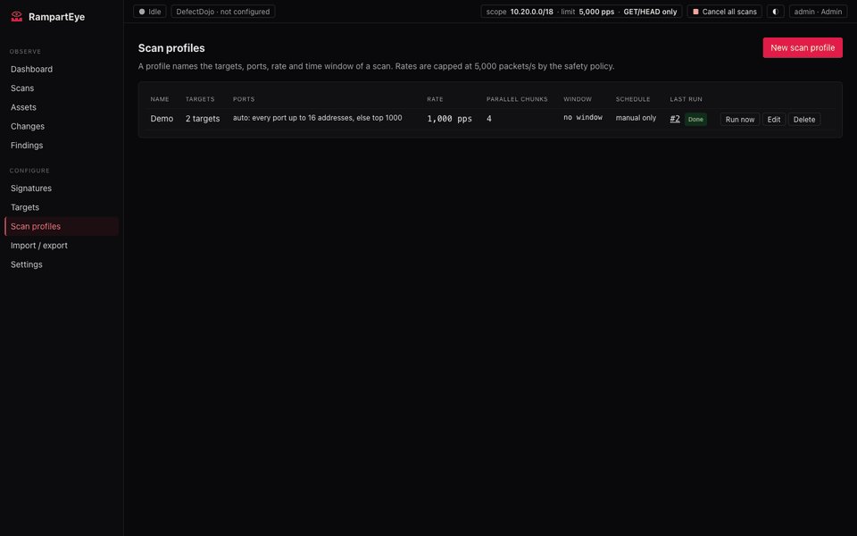
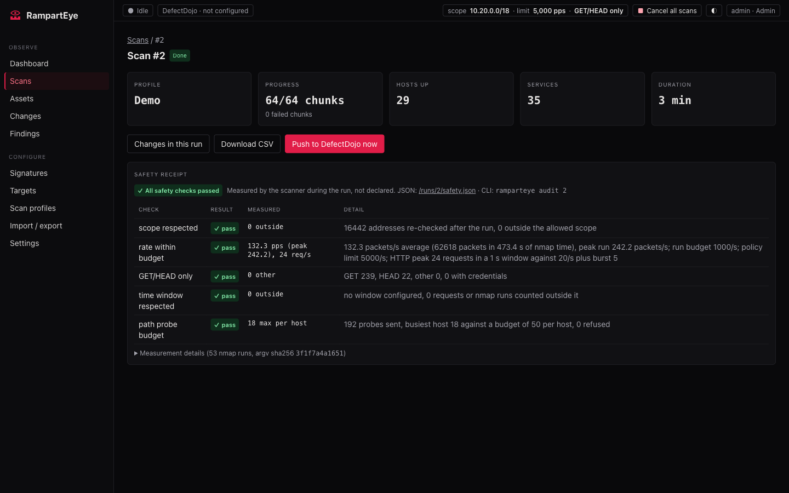
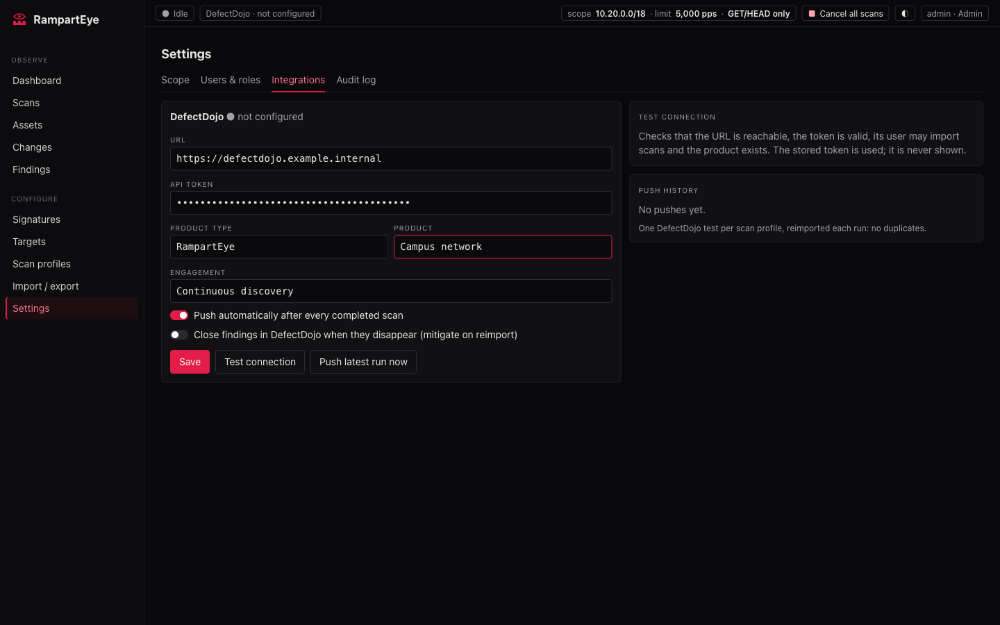
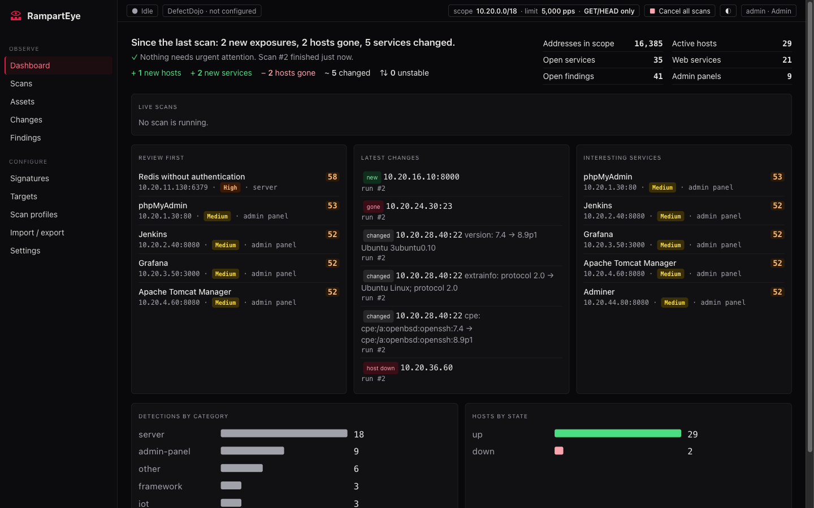
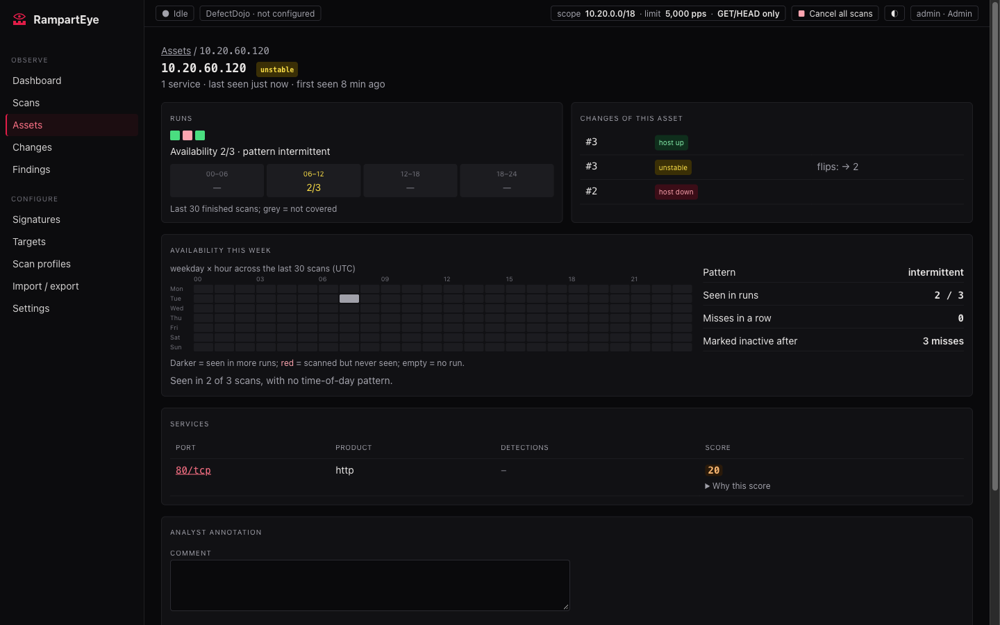

<p align="center">
  <picture>
    <source media="(prefers-color-scheme: dark)" srcset="docs/logo/ramparteye-lockup-dark.svg">
    
  </picture>
</p>

<p align="center"><b>Watch your perimeter change.</b><br>
Self-hosted, continuous inventory of your internal attack surface, with change detection,
a safety receipt for every scan and DefectDojo built in.</p>

<p align="center"></p>

## Why

Most networks drift. A test server gets left running, someone exposes an admin panel "for a
minute", an appliance is upgraded or quietly goes away. Big platforms find this, but they are
expensive or built for the internet-facing perimeter; one-off nmap runs find it too, but nobody
diffs them by hand every week.

RampartEye is for the networks you own: universities, public institutions, hospitals and
municipalities with large address space and small IT teams, SOC and blue teams in mid-size
companies, MSSPs, and anyone who needs a fast before/after picture. It scans on a schedule,
tells you in plain language what changed since the last run, ranks what to look at first and
sends the findings to DefectDojo, while staying provably inside the scope you allowed.

## Features

- **Change detection** between runs: hosts up/down, new, gone and changed services, unstable
  hosts, latency changes; a plain-language headline ("Since the last scan: 3 new exposures, 1 host
  gone") and a changes timeline.
- **Host drilldown**: state per run, availability by time of day and a weekly heatmap, the
  host's own changes, and its services with detections, score and per-service history.
- **Transparent interest score** for every service: a sum of named rules (severity, admin panel,
  outdated version, exposed database, TLS problems, new service...), not a black box.
- **Signatures in YAML**, 41 built in (admin panels, CMSs, management APIs, TLS problems, outdated
  versions), with CWE, MITRE ATT&CK and remediation; write your own and test them against stored
  history before enabling. See [docs/SIGNATURES.md](docs/SIGNATURES.md).
- **Passive nuclei import**: single-request GET/HEAD templates become RampartEye signatures;
  everything active is rejected with a reason.
- **Safety model**: mandatory scope, GET/HEAD only, packets/s budget, scan windows, a safety
  receipt per run and a "Cancel all scans" control. See
  [docs/SECURITY-MODEL.md](docs/SECURITY-MODEL.md).
- **DefectDojo from the UI**: connection test, auto-push after every scan, reimport without
  duplicates, push history and a status chip. See [docs/DEFECTDOJO.md](docs/DEFECTDOJO.md).
- **Two-phase nmap scanning** (discovery, then service detection) split into chunks across
  workers, with retries, pause/resume at window end and live progress over SSE.
- **Roles and audit log**: Admin, Operator, Analyst and Viewer, custom roles, analyst notes and
  false-positive marking.
- **Export and import**: CSV, JSON and DefectDojo Generic Findings; import nmap XML or Generic
  Findings as a run.
- **Encrypted at rest**: PostgreSQL with Percona pg_tde (whole cluster, WAL included) plus AES-GCM
  for stored secrets.
- **One binary, one command to install**: Go, server-rendered htmx UI embedded in the binary, no
  Node.js anywhere.

## Quick start

You need Docker with Compose 2.24 or later.

**1. See it work on the bundled demo lab** (any OS, about 1.5 GiB RAM, about 20 images):

```sh
curl -fsSL https://raw.githubusercontent.com/chrobson/ramparteye/main/install.sh | sh -s -- --demo
```

Open <http://localhost:9080>, sign in with one of the four demo accounts printed at the end
(admin, operator, analyst, viewer), go to **Scans** and run the **Demo** profile (about 3.5
minutes). Then change the lab and scan again to see change detection at work:

```sh
git clone https://github.com/chrobson/ramparteye ramparteye-src && cd ramparteye-src
set -a && . ../ramparteye/.env && set +a   # the demo's database password and image
lab/change.sh run2                         # hosts gone, new services, upgraded versions
```

The demo is self-contained: its targets live on an internal Docker network (`10.20.0.0/18`) with
no route out, and the app may scan only that network. Details: [lab/README.md](lab/README.md).
Remove it with `cd ramparteye && docker compose down -v`.

**2. Scan your own network** (Linux host; the app uses host networking to reach the LAN):

```sh
curl -fsSL https://raw.githubusercontent.com/chrobson/ramparteye/main/install.sh | sh -s -- --scope 192.168.1.0/24
cd ramparteye && docker compose logs app | grep "shown once"   # one-time admin password
```

Nothing is scanned by default: the scope you pass (`RAMPART_ALLOWED_CIDRS` in `.env`) is the only
address space RampartEye will touch. Sign in as `admin`, set a new password, add targets on the
**Targets** page and create a scan profile. Every setting is described in
[docs/CONFIGURATION.md](docs/CONFIGURATION.md); Docker Desktop on macOS and Windows cannot reach
your LAN from a container, so use a Linux host for real scans.

<details>
<summary>Troubleshooting</summary>

- **"no scan scope configured"**: set `RAMPART_ALLOWED_CIDRS` in `.env` and run
  `docker compose up -d`.
- **The demo does not start**: `10.20.0.0/18` overlaps a network the Docker host already uses
  (LAN, VPN, another Docker network), or another demo stack is running. One demo per Docker host.
- **Locked out after failed logins**: the lock lifts after 15 minutes, or restart the app
  (`docker compose restart app`). `docker compose exec app ramparteye reset-admin` sets a new
  one-time password but does not clear the lock.
- **Everyone is locked out at once behind a reverse proxy**: set `RAMPART_TRUSTED_PROXIES`, or
  every client shares the proxy's address. See
  [docs/CONFIGURATION.md](docs/CONFIGURATION.md#reverse-proxy).
- **Live progress never updates behind a proxy**: the proxy buffers `/events`; disable buffering
  for it.
- **Lost the secrets volume**: the stored DefectDojo token cannot be decrypted any more; enter it
  again. Back up the `secrets` and `pgkeys` volumes with `pgdata`.

</details>

## Safety model

RampartEye is built to be safe to point at production networks you are responsible for:

- **Mandatory scope.** With no `RAMPART_ALLOWED_CIDRS` every scan and target import is refused.
  Targets are checked at import and again right before every nmap run; names that resolve
  outside the scope, partly overlapping CIDRs and excluded addresses never reach nmap.
- **No payloads.** Fingerprinting and signatures send only `GET` and `HEAD`, never a body or
  credentials; every redirect and DNS answer is scope-checked before connecting.
- **Bounded intensity.** A packets/s limit per instance and per profile, scan windows, and a
  per-host budget for signature path probes.
- **Safety receipt.** Every run records what was actually sent and re-checks it: scope respected,
  rate within budget, GET/HEAD only, time window respected, path probe budget. Available in the UI,
  as JSON and from `ramparteye audit`.
- **Cancel all scans** stops every running scan within seconds, still saves the receipt and
  applies no diff and no DefectDojo push for cancelled runs.

Only scan networks you are authorised to scan. The full model, including what at-rest encryption
does and does not protect, is in [docs/SECURITY-MODEL.md](docs/SECURITY-MODEL.md).

<p align="center"></p>

## DefectDojo

Configure DefectDojo under **Settings → Integrations**: URL, API token (stored encrypted),
product type, product and engagement. **Test connection** checks the URL, the token and the
permission to import. From then on every completed scan is pushed automatically as a
`Generic Findings Import` reimport into one DefectDojo test per scan profile, so findings are
deduplicated and, if you enable it, closed when they disappear. The top bar shows the connection
state and the last push; the push history lists every attempt with its finding deltas and errors.
`ramparteye dojo push` does the same from scripts. Details: [docs/DEFECTDOJO.md](docs/DEFECTDOJO.md).

<p align="center"></p>

## Screenshots

| Dashboard | Host drilldown |
|---|---|
|  |  |

## Comparison

RampartEye is deliberately narrow: continuous, scheduled discovery of networks you own, with
change detection, a provable safety budget and DefectDojo. How it relates to well-known tools:

| | Focus | Where RampartEye differs |
|---|---|---|
| [runZero](https://www.runzero.com/) | Commercial asset inventory and exposure management, very deep fingerprinting, SaaS console with on-prem explorers | Open source and fully self-hosted; less fingerprint depth, but a safety receipt per scan, transparent scoring and native DefectDojo push |
| [IVRE](https://ivre.rocks/) | Open-source network recon framework (Python): stores nmap/masscan/passive data, "your own Shodan" | RampartEye schedules and diffs scans for you, explains changes in plain language and ranks services; IVRE is the better toolbox for large-scale research and passive data |
| [ProjectDiscovery](https://projectdiscovery.io/) (naabu, httpx, nuclei) | Fast CLI building blocks for recon and active vulnerability checks, mostly internet-facing | RampartEye is a long-running service with history and a UI; it imports only the passive subset of nuclei templates and never sends payloads |
| [reNgine](https://github.com/yogeshojha/rengine), [Amass](https://github.com/owasp-amass/amass) | External recon: subdomain enumeration, OSINT, web reconnaissance of internet targets | RampartEye does no internet recon at all: it inventories internal address space you are authorised to scan |

## Documentation

- [Architecture](docs/ARCHITECTURE.md): packages, scan pipeline, data model.
- [Configuration](docs/CONFIGURATION.md): every `RAMPART_*` variable, install options, reverse
  proxy.
- [Security model](docs/SECURITY-MODEL.md): scope, intensity, safety receipt, keys, legal note.
- [DefectDojo](docs/DEFECTDOJO.md): mapping, deduplication, push history.
- [Signatures](docs/SIGNATURES.md): the YAML format and the nuclei import.
- [Development](docs/DEVELOPMENT.md): building, tests, CSS, the lab.
- [Contributing](CONTRIBUTING.md) and [reporting vulnerabilities](SECURITY.md).

## Roadmap

What is planned and what is deliberately out of scope: [ROADMAP.md](ROADMAP.md).

## Origins

Started as a solo project built in under 18 hours at HackNation 2026 for the AGH Attack Surface Intelligence challenge; scored 7.34 against a 6.84 average. This repository is its clean, test-first rewrite.

The hackathon prototype: <https://github.com/chrobson/hacknation-agh>.

## Licence

MIT, see [LICENSE](LICENSE). Vendored htmx files are 0BSD, see
[web/static/htmx.LICENSE](web/static/htmx.LICENSE). The wordmark is set in IBM Plex Sans (SIL Open
Font License), converted to outlines.
